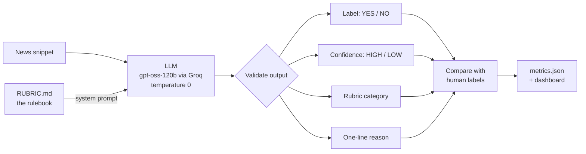

# News Event Classifier

**Reads a news headline and tells you whether it describes an event that could lead to an insurance claim.**

A fire that destroys a warehouse? **YES.** A storm forecast for next week? **NO.** A reinsurer's share price falling? **NO.** A ship running aground with no oil spill? Still **YES**, because the ship itself is damaged.

That last case shows why this is harder than it looks. This project solves it with a large language model guided by a written rulebook (the *rubric*). Every decision comes with a confidence level and the specific rule that drove it.

| Metric | Score (40 labelled snippets) |
|---|---:|
| Accuracy | **95.0%** |
| Precision | **100%** (no false alarms) |
| Recall | **90.0%** (caught 18 of 20 real events) |
| F1 | **94.7%** |

---

## Contents

1. [What it looks like](#what-it-looks-like)
2. [Quick start](#quick-start)
3. [How it works](#how-it-works)
4. [The key finding: the rulebook mattered more than the model](#the-key-finding-the-rulebook-mattered-more-than-the-model)
5. [Results in detail](#results-in-detail)
6. [Honest limitations](#honest-limitations)
7. [What I would build next](#what-i-would-build-next)
8. [Project structure](#project-structure)
9. [How AI tools were used](#how-ai-tools-were-used)

---

## What it looks like

Give it a snippet. It returns a label, a confidence level, the rubric category it applied, and a one-line reason.

| Snippet | Label | Confidence | Why |
|---|:---:|:---:|---|
| *"A container vessel has run aground off Sri Lanka; salvage tugs are en route and no oil spill has been reported so far."* | **YES** | HIGH | transport/asset casualty: the grounding creates a hull and salvage claim |
| *"An oil pipeline in Alberta was shut down as a precaution after sensors detected a pressure anomaly; no leak has been confirmed."* | **NO** | HIGH | precaution without confirmed loss |
| *"Heavy snowfall closed several Alpine passes overnight; no incidents were reported and roads reopened by morning."* | **NO** | HIGH | no meaningful loss |
| *"Local media report a partial collapse at a copper mine in northern Chile; the operator has not confirmed casualties; a single eyewitness is cited."* | **YES** | **LOW** | physical damage, but sourcing is thin, so it should go to a human |

The **LOW** confidence flag matters. In production, those are the items you send to an analyst for review instead of trusting automatically.

---

## Quick start

### 1. Install

You need **Python 3.9+** and a free **[Groq API key](https://console.groq.com/keys)**.

```bash
git clone https://github.com/hari9618/News-Event-Classifier.git
cd News-Event-Classifier
pip install -r requirements.txt
```

Create a `.env` file in the project folder (or copy `.env.example`):

```
GROQ_API_KEY=your_key_here
```

The free tier is enough. A full evaluation run uses about 120 API calls.

> **No API key?** You can still look at every result. All prediction files and `metrics.json` are committed, and the rules baseline (`classify.py`) runs offline.

### 2. Try the web demo

```bash
uvicorn app:app --reload
```

Open **http://127.0.0.1:8000**. From there you can:

- paste a single snippet and see the decision,
- upload a CSV (columns `id`, `snippet`) to classify up to 50 at once. Try `data/snippets.csv`,
- browse the evaluation dashboard: metrics, confusion matrix, system comparison, and a written analysis of every disagreement.

### 3. Run from the command line

| What | Command | Output |
|---|---|---|
| Classify with the rubric (main system) | `python llm_classify.py` | `llm_predictions.csv` |
| Classify **without** the rubric (for comparison) | `python llm_classify.py --naive` | `llm_naive_predictions.csv` |
| Rules-only baseline (no API key needed) | `python classify.py` | `predictions.csv` |
| Score everything against the human labels | `python evaluate.py` | `metrics.json` + printed report |
| Run the test suite (87 checks) | `python test_project.py` | pass/fail report |

### 4. Use it on your own news

Nothing is tied to the 40 sample snippets. Any CSV with an `id` column and a `snippet` column works:

```bash
python llm_classify.py --input my_feed.csv --output my_predictions.csv
```

---

## How it works



**Step 1: Write the rules first.** Before any code, I wrote [`RUBRIC.md`](RUBRIC.md) to define what counts as an insurable loss event. It separates real events from things that only *sound* like events:

- forecasts and warnings (the storm hasn't hit yet)
- precautions with no confirmed damage
- planned maintenance
- financial, market and regulatory news
- court rulings about old events
- cyber exposures with no confirmed disruption

It also has explicit rules for the grey areas: slow-onset hazards like drought, ships and planes damaged without injuries, and reports from a single unverified source.

**Step 2: Label the data by hand.** I applied the rubric to all 40 snippets myself and saved the results in [`labels.csv`](labels.csv), with a written justification for every low-confidence call. **The labels were frozen before the final evaluation and never changed to match the model.** When the model disagreed, I treated that as a finding to analyse, not a label to correct.

**Step 3: Turn the rubric into a prompt.** [`prompt.py`](prompt.py) passes the rubric to the model almost word for word. The model must answer in JSON and name the **exact rubric category** that decided its call. That requirement is what makes errors explainable: when it gets something wrong, you can see which rule it misapplied.

**Step 4: Don't trust the model's formatting.** [`llm_classify.py`](llm_classify.py) checks every response. Anything that isn't a valid `YES`/`NO` becomes `NO`, and anything that isn't `HIGH`/`LOW` becomes `LOW`, so a malformed answer can never pass as a confident one. It also retries with backoff when the free-tier rate limit kicks in.

**Step 5: Compare against simpler alternatives.** The same 40 snippets are run through a rules-only classifier and through the LLM with no rubric at all, so the gains can be attributed to the right cause.

### Why so simple?

No RAG, no vector database, no embeddings, no fine-tuning, no agent framework. That was a deliberate choice:

- The snippets are short and self-contained, so there is nothing to retrieve.
- With only 40 examples, any trained model would be tested on the same rows it learned from, so its score would mean nothing.
- A clear rulebook plus a capable model was the simplest thing that fit the problem.

---

## The key finding: the rulebook mattered more than the model

Same model, same data. The only thing that changes is the prompt:

| System | Accuracy | Precision | Recall | F1 |
|---|---:|---:|---:|---:|
| LLM, **no rubric** | 80.0% | 71.4% | 100% | 83.3% |
| Rules / regex baseline | 90.0% | 100% | 80.0% | 88.9% |
| LLM + original rubric | 92.5% | 100% | 85.0% | 91.9% |
| **LLM + refined rubric (final)** | **95.0%** | **100%** | **90.0%** | **94.7%** |

Without the rubric, the model flags almost anything that sounds dangerous. It produced **8 false alarms**, and every one was a case the rubric explicitly covers (forecasts, precautions, market news). Adding the rubric removed all of them.

The final gain came from **one sentence**. While auditing my own labels, I noticed two of them relied on a distinction the rubric never actually wrote down: how much to trust a single unverified source. I added that sentence to the rubric and the prompt, then re-ran everything. Two things happened:

1. **Recall went from 85% to 90%.**
2. **Confidence started working.** Before the change, the model said HIGH on all 40 items, which made it impossible to route uncertain cases to a human. After the change, it marked exactly the two weakly sourced snippets as LOW.

Both versions are committed (`llm_predictions_v1.csv` before, `llm_predictions.csv` after), so you can reproduce the comparison.

**Takeaway:** for this kind of task, clear decision rules can be worth more than a bigger model or a more complex system.

---

## Results in detail

### Confusion matrix (final system)

|  | Actually YES | Actually NO |
|---|:---:|:---:|
| **Predicted YES** | 18 | 0 |
| **Predicted NO** | 2 | 20 |

Zero false alarms, two misses. For an insurer, misses are the worse error: a missed event fails silently, while a false alarm costs an analyst about thirty seconds of reading. So recall is where I'd focus next.

### Where the model and I still disagree

| # | Snippet (summary) | Me | Model | What it reveals |
|---|---|:---:|:---:|---|
| 25 | Drought: reservoirs at 30%, irrigation restrictions already in force | YES | NO | The rubric's slow-onset rule sits in the "borderline" section, so it reads as optional |
| 33 | Dam cracks after heavy rain; downstream villages evacuated | YES | NO | The rubric needs a rule for when asset damage outweighs a precautionary response |

A third case, **#18** (emergency landing after an engine-fire warning), was wrong in the earlier version and is correct after the rubric refinement.

The full analysis of each case, including which of us I think is right and why, is in **[EVALUATION.md](EVALUATION.md)**.

### Reproducibility

`temperature=0` does **not** make the model fully deterministic, so I tested it instead of assuming. Across three identical runs:

- 39 of 40 answers were identical,
- one borderline item (#18) flipped between runs.

That is a real ±2.5 point swing in headline accuracy, which shows how much a single example can move the numbers on a 40-item set. The unstable item is also the one the rubric was vaguest about, which supports the main finding: ambiguity in the rules shows up as instability in the model.

---

## Honest limitations

- **40 examples is small.** Treat these numbers as a first evaluation, not a production estimate.
- **One labeller.** All ground truth comes from one person, and the rubric was refined after seeing the data.
- **No separate test set.** Development and evaluation used the same 40 snippets.
- **Two prompt examples overlap the test data.** The rubric's two illustrations (pipeline shutdown, court ruling) match snippets 15 and 17, so agreement on those two is partly built in. This is noted in `prompt.py` and `EVALUATION.md`.
- **The snippets are fictional.** They come from the Leadenhall Analytics take-home assessment, not live news.

---

## What I would build next

1. **Fix the two open rubric gaps:** a precedence rule for asset damage vs. precaution (#33), and move the slow-onset rule out of "borderline" (#25).
2. **Stronger ground truth:** two independent labellers, with disagreements settled and agreement measured using Cohen's kappa.
3. **Proper data splits:** a development set and a frozen, unseen evaluation set.
4. **More data:** several hundred real news items, with extra samples of the hard cases.
5. **A numeric confidence score,** so you can choose an operating point on a precision-recall curve.
6. **Structured extraction:** peril, location, severity. The real business question isn't "is this an event?" but "does this event affect my portfolio?"
7. **A rules-then-LLM cascade:** the rules baseline has 100% precision here, so it could cheaply handle the obvious cases and send only the hard ones to the LLM.

---

## Project structure

```
News-Event-Classifier/
├── RUBRIC.md                  # The classification rules (start here)
├── labels.csv                 # Human ground-truth labels, frozen
├── data/snippets.csv          # The 40 news snippets
│
├── prompt.py                  # Rubric as the LLM system prompt (+ no-rubric version)
├── llm_classify.py            # Main classifier (Groq, gpt-oss-120b)
├── classify.py                # Rules-only baseline, no API needed
├── evaluate.py                # Scores every system, writes metrics.json
│
├── llm_predictions.csv        # Final predictions
├── llm_predictions_v1.csv     # Predictions before the rubric refinement
├── llm_naive_predictions.csv  # Predictions with no rubric
├── predictions.csv            # Rules baseline predictions
├── metrics.json               # All scores, used by the dashboard
├── disagreement_notes.json    # Written analysis of each disagreement
├── EVALUATION.md              # Full evaluation write-up
│
├── app.py                     # FastAPI backend for the demo
├── static/index.html          # Demo frontend
├── test_project.py            # 87 end-to-end checks
└── requirements.txt
```

**Tech:** Python · Groq API (`openai/gpt-oss-120b`) · FastAPI · Uvicorn · vanilla HTML/JS

---

## How AI tools were used

Claude Code helped write the implementation: the Python code, Groq integration, evaluation script, rules baseline, FastAPI backend, frontend, and tests.

**The analytical decisions were mine:** what counts as YES, every clause in the rubric, every human label, how to read the disagreements, which metrics matter, and the decision not to use RAG or agent frameworks.

**Where I overrode the tool:**

- **It suggested relabelling snippet 38 to match the model. I refused.** Ground truth that moves to agree with the model isn't ground truth.
- Its first rules baseline treated "no injuries reported" as "no loss." That bug causes four of the baseline's misses. I kept it on purpose, because the failure is instructive.
- It invented its own rule-code scheme for an early prompt. I had it removed so the prompt mirrors the real rubric.
- When an early re-run hit a rate limit 28 snippets in, the partial results looked good. I didn't report them. I reverted and waited until a complete run was possible, so every committed number can be reproduced from the committed prompt.

---

## Data and credits

The 40 news snippets are fictional and come from the **Leadenhall Analytics** take-home assessment. Model: `openai/gpt-oss-120b`, served through Groq. No external datasets or code beyond the packages in `requirements.txt`.
